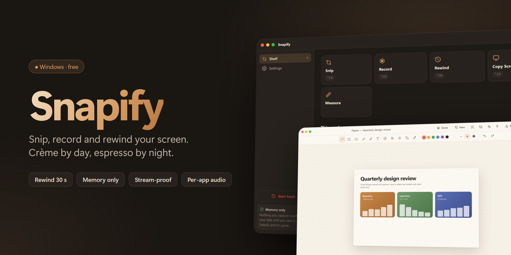
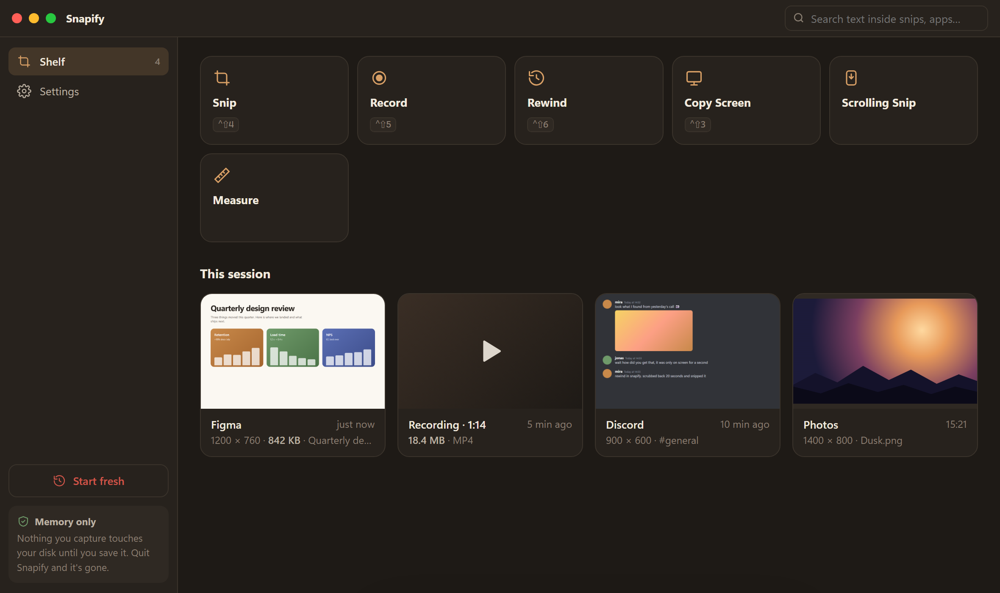
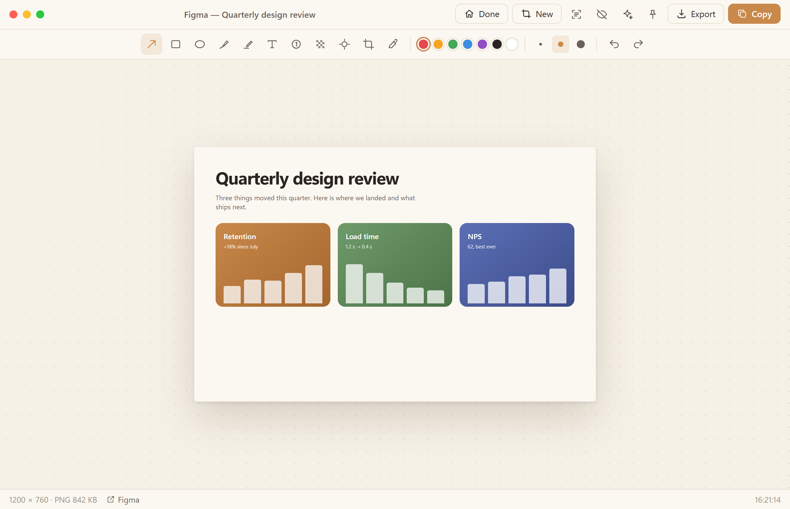

  <b>The snipping tool Windows should have shipped.</b> 
  Snip, record and rewind your screen. Everything stays in memory until you decide to save it.

  
  
  

---

## Download

Grab **`Snapify_x.y.z_x64-setup.exe`** from the [latest release](https://github.com/aywalh/snapify/releases/latest) and run it. No admin rights needed.

Snapify updates itself: when a new version is out, a banner appears on the shelf. One click installs it and restarts.

## What it does

<table>
<tr><td width="50%"></td><td width="50%"></td></tr>
<tr><td align="center">The shelf, in espresso</td><td align="center">The editor, in crème</td></tr>
</table>

| | |
|---|---|
| **Snip** | Drag a region, or click any window or button to grab it pixel-perfect. Annotate with arrows, shapes, text, steps, blur and crop. |
| **Record** | Region or full-screen video with desktop sound and mic, each switchable live from the record bar. Pick which apps are heard. |
| **Rewind** | Missed it? Scrub back up to two minutes and snip what already disappeared. Held in RAM only. |
| **Copy Screen** | One key copies the screen. With several monitors the screen freezes and you click the one you want. |
| **Scrolling snip** | Capture a whole long page in one image. |
| **Pin & Live Pin** | Float any snip above everything, or keep a live view of a part of your screen. |
| **Measure** | Pixel distances and sizes on anything on screen. |
| **Export** | PNG, JPEG, WebP or AVIF. Set a max file size (say, 10 MB for Discord) and Snapify finds the best quality that fits. |
| **Drag & drop** | Drop or paste images and videos into Snapify. Ctrl + drag a snip out into Discord, Explorer or mail. |

## Private by design

- Snips, recordings and Rewind history live **in RAM only** and vanish when you quit.
- Nothing is written to disk until you press Save, and saved files carry **no metadata**.
- Copies skip clipboard history, cloud clipboard and clipboard managers.
- Snapify never appears in its own snips. **Stream-proof** decides what Discord, OBS and screen sharing see of it: normal, invisible or black.
- No accounts, no telemetry. Text recognition runs offline. The only network request is the update check, and you can turn it off.

## Shortcuts

| Keys | Action |
|---|---|
| `Ctrl` `Shift` `4` | Snip |
| `Ctrl` `Shift` `5` | Record / stop |
| `Ctrl` `Shift` `6` | Rewind |
| `Ctrl` `Shift` `3` | Copy screen |
| `Ctrl` `Shift` `2` | Open the shelf |

All shortcuts can be changed in Settings.

## AI tools (optional)

Snapify includes an MCP server, so an assistant like Claude can take a screenshot or read screen text when you ask it to. It's off until you enable it in Settings → Privacy.

## Feedback

Found a bug or have an idea? [Open an issue](https://github.com/aywalh/snapify/issues).

---

Snapify is free to use, but it is not open source. © 2026 aywalh. All rights reserved. See [LICENSE](LICENSE). Recording uses <a href="https://ffmpeg.org">FFmpeg</a>, licensed under the GPL; it ships as a separate program next to Snapify.
